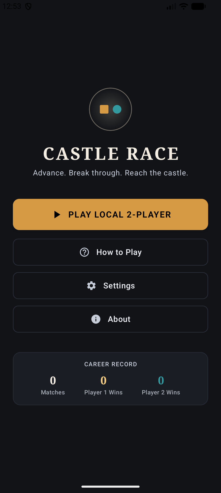
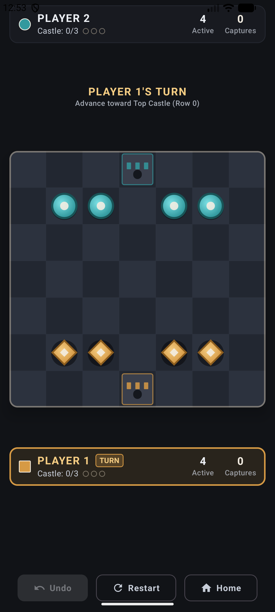
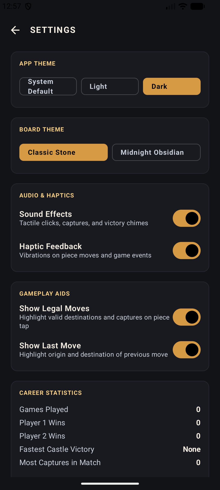
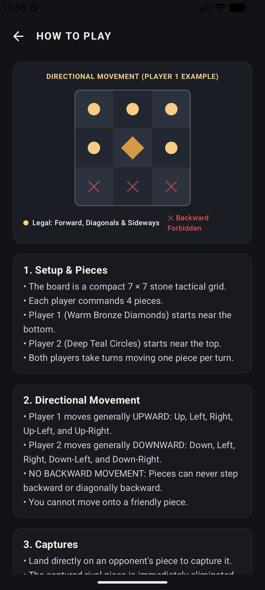
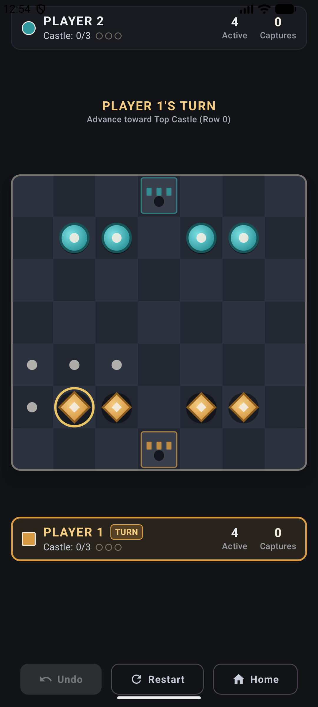
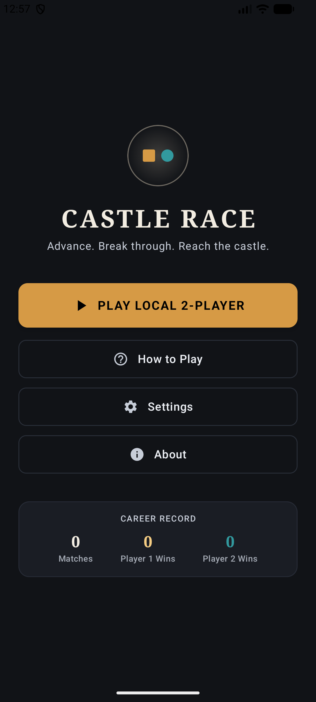

# Castle Race 🏰♟️

**Castle Race** is an engaging, turn-based strategic board game built for Android using **Jetpack Compose** and **Material 3**. Race your pieces across the castle grid, outmaneuver your opponent, manage tactical captures, and claim victory!

---

## ✨ Features

- **Modern Android Tech Stack**: Built entirely with **Jetpack Compose**, **Material 3**, Kotlin Coroutines, and ViewModel architecture.
- **Strategic Gameplay**: Deep turn-based mechanics with tactical positioning, movement rules, and win conditions (`CastleRaceGameEngine`).
- **Immersive Audio & Haptics**: Integrated sound effects (`SoundController`) and haptic feedback (`HapticController`) for tactile game responses.
- **Rich User Interface**:
  - **Home Screen**: Start game, view stats, settings, how to play, and about screens.
  - **Game Screen**: Interactive board (`BoardView`), player panels (`PlayerPanel`), move tracking, and turn indicators.
  - **Settings & Preferences**: Configurable options stored with PreferencesManager (`PreferencesManager`).
  - **Comprehensive Instructions**: Dedicated "How to Play" guide with visual explanations.
- **Robust Unit & Instrumented Testing**: Game engine logic thoroughly tested with JUnit tests (`CastleRaceGameEngineTest`).

---

## 📸 Screenshots

| Home & Menu | Game Screen | Settings |
| :---: | :---: | :---: |
|  |  |  |

| Piece Movement | Selection & Board | Result / End Game |
| :---: | :---: | :---: |
|  |  |  |

---

## 🛠️ Architecture & Tech Stack

- **UI Framework**: Jetpack Compose, Material 3, Compose Layouts, Custom Canvas rendering for board components.
- **Architecture**: MVVM (Model-View-ViewModel) with StateFlow.
- **Game Logic**: Pure Kotlin game state machine (`CastleRaceGameEngine`, `CastleRaceState`, `CastlePiece`).
- **Data & Preferences**: `PreferencesManager` for persisting user settings and stats.
- **Audio & Sensory**: Sound management and vibrator haptic effects.

---

## 🚀 Getting Started

### Prerequisites
- Android Studio Ladybug or newer.
- Android SDK API level 24 or higher (minSdk 24, targetSdk 34+).
- JDK 17 or higher.

### Building and Running
1. Clone the repository:
   ```bash
   git clone https://github.com/abdullah-ateeq/Castle-Race.git
   ```
2. Open the project in Android Studio.
3. Sync Gradle and run the `:app` module on an emulator or physical Android device.

---

## 📦 Project Structure

```
app/src/main/java/com/example/castlerace/
├── audio/            # Sound & Haptic controllers
├── data/             # Preferences and persistence manager
├── logic/            # Game engine and movement rules
├── model/            # Game state, pieces, settings, and stats
├── ui/
│   ├── components/   # Reusable UI components (BoardView, PlayerPanel)
│   ├── navigation/   # Navigation graph & screens definitions
│   ├── screens/      # Screen composables (Home, Game, Settings, etc.)
│   ├── theme/        # Material 3 colors, typography, and themes
│   └── viewmodel/    # ViewModels for game and settings state management
└── MainActivity.kt   # Main entry point
```

---

## 🤝 Contributing

Contributions, issues, and feature requests are welcome!

---

## 📄 License

This project is open-source and available under the MIT License.
